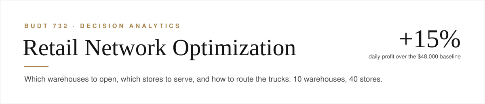

A retailer has 10 candidate warehouses and 40 candidate stores. Each store's demand falls with price, neighboring stores cannot differ in price by more than $5, every open warehouse pays rent, trucks carry 500 units and drivers work 8 hours. Which warehouses do you open, which stores do you serve, at what price, and how do the trucks run? The current plan makes $48,000 a day. The target was 10% better.

**Result: $55,210.64 a day, 15% over baseline.** 4 warehouses open, all 40 stores served, 22 routes.

**Course:** BUDT 732 Decision Analytics, University of Maryland Smith School, Fall 2025. Team of 4. Solved with AMPL and Gurobi.

---

## Approach

One model with pricing, location, and routing together is not tractable at this size, so the problem is split into three stages that feed each other.

**1. Price.** Store-by-store pricing runs into the neighbor price-gap rule, which turns the problem nonlinear. A single price for every store satisfies the rule automatically. $38 was the best uniform price on the demand curves from Part 1. With price fixed, each store's demand and daily profit contribution become constants.

**2. Location and assignment (MILP).** Binary variables for open stores, open warehouses, and store-to-warehouse assignments. Constraints: each open store is assigned to exactly one warehouse, only open warehouses can serve, warehouse capacity, and a feasibility parameter that rules out any pairing where a round trip plus unloading exceeds 8 hours. Objective: store profit minus warehouse rent. Gurobi solves it in 137 branch-and-bound nodes.

```
maximize  sum(store_profit[i] * x[i]) - sum(wh_rent[w] * y[w])
s.t.      sum_w z[w,i] = x[i]            each open store gets one warehouse
          z[w,i] <= y[w]                 only from open warehouses
          z[w,i] <= feasible[w,i]        round trip fits in a shift
          sum_i demand[i] * z[w,i] <= cap[w]
```

**3. Routing (greedy).** For each warehouse, start a route at the nearest unserved store, then keep adding the nearest store that fits in the truck and keeps the route under 480 minutes including 30 minutes of unloading per stop. Each route costs $200 plus $0.10 a minute. Because the MILP only assigned stores that can be served in a single round trip, routing always succeeds.

| Stage | Value |
|---|---|
| MILP profit (store margin minus rent) | $60,498.04 |
| Routing cost (22 routes) | $5,287.40 |
| **Daily profit** | **$55,210.64** |

## Solution

| Warehouse | Stores | Routes | Daily volume |
|---|---|---|---|
| 3 | 9 | 4 | 1,159 units |
| 4 | 11 | 5 | 1,298 |
| 6 | 10 | 6 | 1,214 |
| 7 | 10 | 7 | 1,329 |

Full assignments are in `outputs/routes.txt`, one line per route: warehouse, then `store:quantity` for each stop.

## My role

Built several of the intermediate models on the way to this one, including a per-store pricing model and an early warehouse-assignment model in AMPL. The final solution uses the integer-programming formulation from class for location and assignment with a greedy heuristic for routing.

## Repository

```
optimize.py                 the full pipeline: demand, MILP, routing, outputs
model/part2.mod             AMPL model
data/                       store demand curves and rent, warehouse rent and capacity, travel-time matrices
outputs/                    warehouses.txt, stores.txt, routes.txt (the submitted solution)
notebooks/part2_colab.ipynb the same pipeline as it ran in Colab
docs/report.docx            report with the full algebraic formulation
```

**Run it:** `pip install amplpy pandas`, activate an AMPL license with Gurobi (`AMPL_LICENSE_UUID`), then `python optimize.py` from the repo root.

**Tools:** AMPL, Gurobi, Python (pandas, amplpy)
